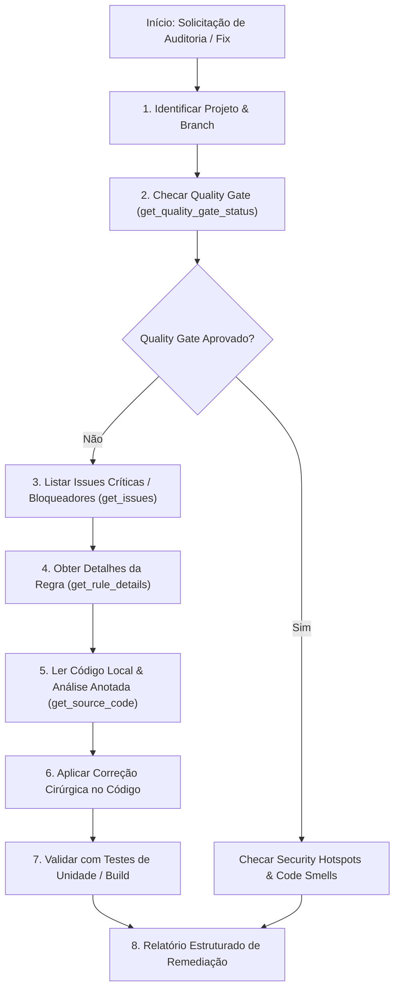

# SonarQube Agent Skill (Quality Gate & Automated Remediation)

Skill especializada em governança de qualidade de código, segurança estática (SAST) e remediação automatizada baseada no ecossistema SonarQube (SonarQube Server / SonarQube Cloud / SonarQube Agent).

Atua como o co-piloto de verificação contínua no ciclo de desenvolvimento, garantindo conformidade com a metodologia **Clean as You Code**, validação estrita de Quality Gates e correção cirúrgica de dívida técnica.

---

## 🎯 Pilares e Capacidades

1. **Validação de Quality Gate (Pre-PR & CI/CD)**: Avalia se o branch/projeto atinge os critérios de aceite (0 bugs críticos/bloqueadores, cobertura mínima de testes, limites de duplicação e rating A em confiabilidade e segurança).
2. **Remediação Automatizada de Issues**: Identifica falhas via SonarQube MCP / API, consulta as regras oficiais (`get_rule_details`), analisa o contexto do código-fonte e gera correções atômicas e limpas.
3. **Auditoria de Security Hotspots**: Investiga pontos sensíveis de segurança que exigem revisão manual, avaliando superfícies de ataque (autenticação, criptografia, SSRF, injeção) e fornecendo correções seguras.
4. **Inspeção de Métricas & Dívida Técnica**: Analisa cobertura de linhas/condições, complexidade ciclomática/cognitiva, duplicações de código e esforço de remediação.
5. **Clean Code Taxonomy**: Aplica os 4 atributos essenciais do Sonar Clean Code:
   - **Consistência** (código formatado, convenções claras, legível).
   - **Intencionalidade** (código claro, sem efeitos colaterais ocultos, tipos explícitos).
   - **Adaptabilidade** (fácil de estender, desacoplado, sem duplicações).
   - **Responsabilidade** (seguro, sem vazamento de dados, respeita recursos).

---

## 🛠️ Ferramentas SonarQube MCP

Esta skill utiliza as ferramentas do MCP `sonarqube`:

| Ferramenta | Descrição / Uso |
| :--- | :--- |
| `get_projects(query?)` | Localiza o projeto/componente pela chave ou nome |
| `get_project_details(project_key)` | Detalhes cadastrais e configurações do projeto |
| `get_project_branches(project_key)` | Lista branches ativas e status no SonarQube |
| `get_quality_gate_status(project_key, branch?)` | Status de aprovação (`PASSED` ou `FAILED`) e condições violadas |
| `get_issues(project_key, severities?, types?, statuses?, ...)` | Busca bugs, vulnerabilidades e code smells detalhados |
| `get_hotspots(project_key, status?)` | Lista Security Hotspots pendentes de revisão |
| `get_hotspot_details(hotspot_key)` | Detalha a justificativa de risco e o trecho vulnerável |
| `get_rule_details(rule_key)` | Descrição completa da regra Sonar, exemplos de código vulnerável e correção recomendada |
| `get_metrics(project_key, metric_keys?, branch?)` | Métricas de cobertura (`coverage`, `line_coverage`), duplicação (`duplicated_lines_density`), etc. |
| `get_source_code(file_key, from_line?, to_line?)` | Código-fonte anotado com marcadores de violação |
| `get_duplications(file_key)` | Localiza blocos duplicados em arquivos |
| `call_sonar_api(endpoint, params?)` | Chamada direta a qualquer endpoint da SonarQube Web API |

---

## 📋 Fluxo de Execução Recomendado

---

## 🔍 Playbooks Operacionais

### Playbook 1: Auditoria e Relatório de Quality Gate

Quando o usuário solicitar uma verificação geral de qualidade ou antes de abrir um PR:

1. Chamar `get_quality_gate_status(project_key="...", branch="...")`.
2. Se houver falhas, listar as métricas que violaram o gate (ex: *Coverage < 80%*, *Bugs > 0*).
3. Chamar `get_issues(project_key="...", severities=["BLOCKER", "CRITICAL", "MAJOR"], statuses=["OPEN", "CONFIRMED", "REOPENED"])`.
4. Apresentar o resumo executivo em formato de tabela escaneável.

### Playbook 2: Remediação Automatizada de Issues (Fix Loop)

Quando o usuário pedir para resolver issues apontadas pelo SonarQube:

1. Obter a lista de issues prioritárias com `get_issues`.
2. Para cada issue selecionada:
   - Consultar a regra oficial com `get_rule_details(rule_key=issue.rule)`.
   - Localizar o arquivo e a linha no repositório local.
   - Analisar o fluxo de controle e aplicar a correção seguindo as convenções do projeto.
   - Garantir que a correção não altere o comportamento de negócio nem introduza regressões.
3. Rodar os testes automatizados locais (JUnit, Vitest, Jest) para garantir a integridade.

### Playbook 3: Resolução de Security Hotspots

1. Chamar `get_hotspots(project_key="...")`.
2. Para cada hotspot, inspecionar com `get_hotspot_details(hotspot_key="...")`.
3. Avaliar se o trecho representa uma vulnerabilidade real ou um padrão aceitável protegido por camadas adjacentes (ex: sanitização prévia, controle de rede).
4. Propor a alteração de código blindando o ponto crítico (ex: uso de prepared statements, algoritmos criptográficos seguros, tokens anti-CSRF, desativação de DTD em XML).

---

## ⚙️ Variáveis de Ambiente & Autenticação

* `SONARQUBE_URL`: URL da instância SonarQube (ex: `http://10.20.1.35:9000` para a instância interna ou `https://sonarcloud.io` para SonarQube Cloud).
* `SONAR_TOKEN`: Token de autenticação gerado em *My Account > Security* no SonarQube.
