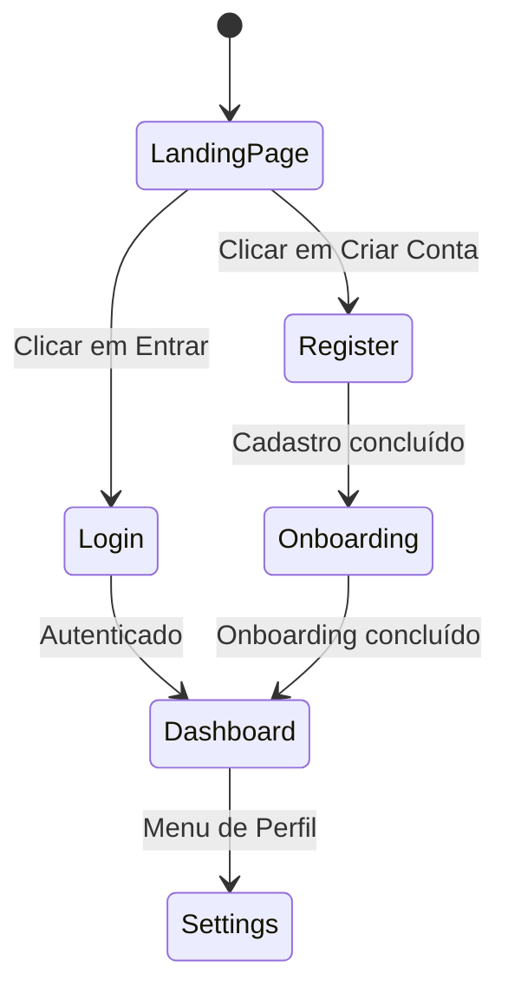

# Estrutura do App Flow (Fluxo do Aplicativo)

O `APP_FLOW.md` mapeia o caminho do usuário pelo aplicativo: jornadas de navegação, telas, fluxo de onboarding e o comportamento detalhado de cada interação/botão.

## Template Padrão

```markdown
# 🗺️ App Flow & User Journeys — [Nome do Projeto]

## 1. Mapa Geral de Telas & Rotas
- `/` — Tela Inicial / Landing Page
- `/login` — Autenticação de Usuário
- `/onboarding` — Fluxo de Boas-vindas e Configuração Inicial
- `/dashboard` — Painel Principal
- `/settings` — Configurações da Conta

## 2. Diagrama de Fluxo de Navegação (Navigation Flow)


## 3. Detalhamento de Jornadas & Telas

### Tela 1: `/login` (Login)
- **Objetivo**: Autenticar o usuário existente.
- **Elementos de Entrada**:
  - Campo Email (validação de formato).
  - Campo Senha (mascarado).
- **Ações dos Botões**:
  - **Botão "Entrar"**:
    - *Sucesso*: Redireciona para `/dashboard` armazenando o token seguro.
    - *Erro*: Exibe mensagem "Credenciais inválidas" sem expor detalhes.
  - **Botão "Esqueci minha senha"**: Abre modal/fluxo de recuperação.

### Tela 2: `/onboarding` (Boas-Vindas)
- **Passo 1**: Apresentação das funcionalidades chave.
- **Passo 2**: Preenchimento do perfil básico.
- **Ações**:
  - **Botão "Próximo"**: Valida os campos do passo atual e avança.
  - **Botão "Pular"**: Define configurações padrão e envia o usuário para o `/dashboard`.

### Tela 3: `/dashboard` (Painel Principal)
- **Componentes**:
  - Header com perfil do usuário e botão Logout.
  - Lista de itens/recursos com paginação.
- **Interações**:
  - Clicar em "Novo Item" → Abre modal de criação.
  - Clicar em um card → Navega para a visão detalhada.
```
