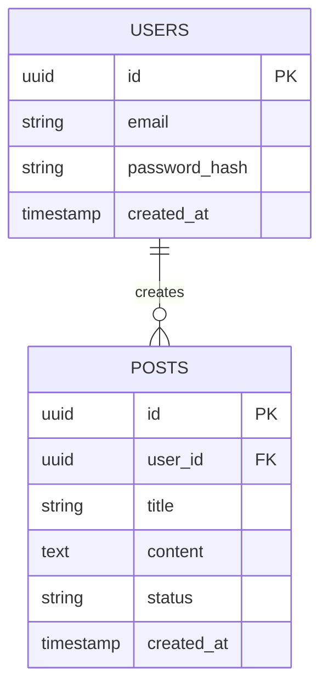

# Estrutura do Backend Schema (Esquema de Banco de Dados)

O `BACKEND_SCHEMA.md` estrutura todos os dados do sistema: tabelas/coleções, tipos de dados, restrições (Primary Keys, Foreign Keys, Nullability), relacionamentos e exemplos de DTOs/payloads.

## Template Padrão

```markdown
# 🗄️ Backend Schema & Data Models — [Nome do Projeto]

## 1. Visão Geral do Banco de Dados
- **Engine**: [ex: PostgreSQL 16 / MongoDB / Supabase]
- **Convenção de Nomes**: [ex: `snake_case` para tabelas e colunas no SQL, `camelCase` para coleções/documentos no NoSQL].

## 2. Diagrama Entidade-Relacionamento (ERD)


## 3. Especificação das Tabelas / Entidades

### Tabela: `users`
| Coluna | Tipo | Chave | Nulo? | Padrão | Descrição |
| :--- | :--- | :--- | :--- | :--- | :--- |
| `id` | `UUID` | PK | Não | `gen_random_uuid()` | Identificador único do usuário |
| `email` | `VARCHAR(255)` | Unique | Não | - | E-mail de login |
| `password_hash` | `VARCHAR(255)` | - | Não | - | Hash da senha (bcrypt/argon2) |
| `role` | `VARCHAR(50)` | - | Não | `'USER'` | Papel no sistema (ADMIN, USER) |
| `created_at` | `TIMESTAMPTZ` | - | Não | `NOW()` | Data de criação |

### Tabela: `posts`
| Coluna | Tipo | Chave | Nulo? | Padrão | Descrição |
| :--- | :--- | :--- | :--- | :--- | :--- |
| `id` | `UUID` | PK | Não | `gen_random_uuid()` | Identificador único do post |
| `user_id` | `UUID` | FK | Não | - | Referência para `users.id` |
| `title` | `VARCHAR(200)` | - | Não | - | Título da postagem |
| `content` | `TEXT` | - | Sim | - | Conteúdo |
| `status` | `VARCHAR(20)` | - | Não | `'DRAFT'` | Status (DRAFT, PUBLISHED) |

## 4. Índices & Desempenho
- `idx_users_email` ON `users(email)`
- `idx_posts_user_id` ON `posts(user_id)`

## 5. Payloads & DTOs Exemplo

### Create User DTO (`POST /api/users`)
```json
{
  "email": "usuario@exemplo.com",
  "password": "SenhaSegura123!",
  "role": "USER"
}
```

### Post Response DTO (`GET /api/posts/{id}`)
```json
{
  "id": "b3c9f2e4-1234-5678-9abc-def012345678",
  "userId": "a1b2c3d4-5678-90ab-cdef-1234567890ab",
  "title": "Primeiro Post",
  "content": "Conteúdo...",
  "status": "PUBLISHED",
  "createdAt": "2026-08-25T12:00:00Z"
}
```
```
