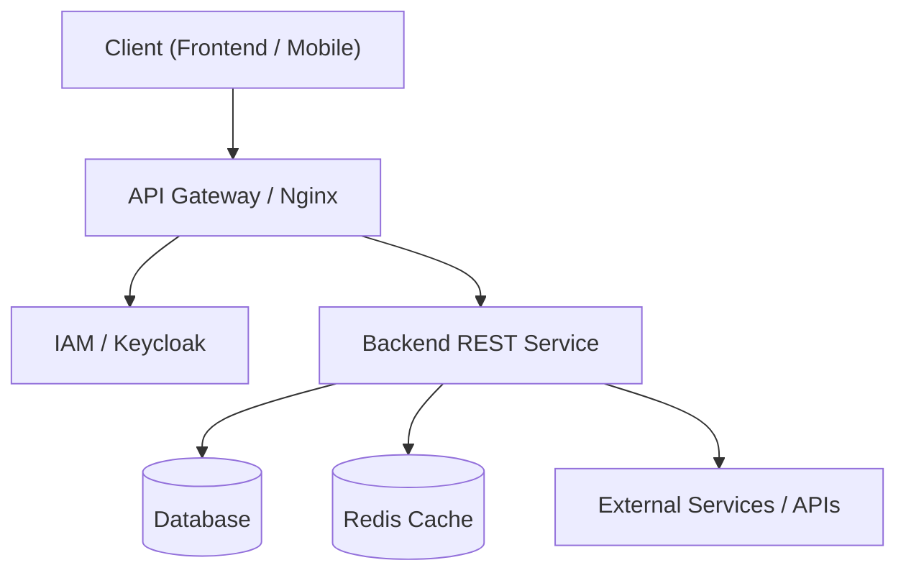

# Estrutura do TDD (Tech Design Document)

O `TDD.md` detalha as decisões técnicas e a arquitetura do sistema, incluindo a stack de tecnologia, ferramentas, infraestrutura, integrações e padrões de código.

## Template Padrão

```markdown
# 🛠️ Tech Design Document (TDD) — [Nome do Projeto]

## 1. Stack Tecnológica
- **Frontend**: [ex: Vue 3 / React / Next.js / Quasar + TypeScript]
- **Backend**: [ex: Node.js / Spring Boot / Python FastAPI]
- **Banco de Dados**: [ex: PostgreSQL / MongoDB / Redis]
- **Autenticação / IAM**: [ex: Keycloak / Supabase Auth / Auth0]
- **Infraestrutura / Containers**: [ex: Docker, Docker Swarm, Nginx, Kubernetes]
- **CI/CD & Observabilidade**: [ex: GitLab CI / GitHub Actions, Prometheus, Grafana, Kibana]

## 2. Arquitetura do Sistema


## 3. Integrações & Serviços Externos
- **[Serviço 1]**: [Finalidade, protocolo REST/gRPC/GraphQL, método de autenticação e tratamento de erros].
- **[Serviço 2]**: [Finalidade, credenciais via variáveis de ambiente].

## 4. Estrutura do Projeto / Pastas
```text
project-root/
├── .docs/                 # Especificações locais (GitIgnored)
├── src/
│   ├── modules/           # Módulos por domínio
│   ├── config/            # Configurações de ambiente e serviços
│   └── shared/            # Utilitários e componentes reutilizáveis
├── tests/                 # Testes unitários e de integração
└── docker-compose.yml
```

## 5. Estratégias de Segurança & Proteção de Dados
- **Autenticação & Autorização**: [RBAC / ABAC, escopos de JWT].
- **Validação de Inputs**: [Sanitização e validação estrita no backend via schemas/DTOs].
- **Gestão de Segredos**: [Uso de `.env` local e segredos injetados por CI/CD. NUNCA commitados].

## 6. Tratamento de Erros & Resiliência
- **Padrão de Resposta de Erro**: Formato JSON padronizado (`timestamp`, `status`, `error`, `message`, `path`, `correlationId`).
- **Retries & Circuit Breaker**: Políticas para falhas em serviços externos.
```
